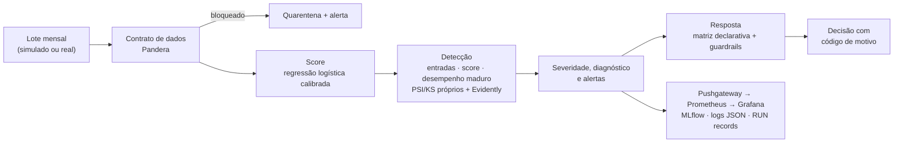

# Credit Scoring — Monitoramento de Drift e Resposta à Degradação

Uma fintech tem um modelo de credit scoring em produção, e a diretoria suspeita que ele vem degradando em silêncio depois de mudanças na economia. Este projeto constrói a camada de **sustentação e confiabilidade** em volta desse modelo:
- contratos que barram dado ruim antes da pontuação;
- detecção de drift em camadas, avaliada contra cenários com ground truth conhecido;
- observabilidade com alertas que levam a playbooks;
- uma política de resposta que diz o que fazer para cada tipo de degradação, com o custo de cada resposta medido;
- governança (LGPD, vieses e análise causal).

> **Escopo acadêmico.** Trabalho acadêmico (Tech Challenge 4, FIAP · ML Engineering). Não existe fintech, cliente nem modelo em produção. A "produção" é simulada localmente com lotes mensais. Ver [Governança e Causalidade](#governança-e-causalidade).

## Arquitetura



Modelo: regressão logística calibrada, champion no MLflow Registry ([model card](docs/model_card.md)). Dados: Lending Club 2007–2018; referência = safra 2013; produção natural = 2014–2018; seis cenários simulados (S0 controle, S1 choque econômico, S2 concept drift, S3 prior shift, S4 bug de unidade, S5 produção natural). Componentes e fluxos em [docs/ARCHITECTURE.md](docs/ARCHITECTURE.md); decisões em [docs/adr/](docs/adr/).

## Resultados

Todo número aponta para o RUN record que o produziu (`docs/runs/`) ou para a evidência versionada.

| Critério | O que foi entregue | Evidência |
|---|---|---|
| **Validação de dados** | Contrato Pandera com 18 regras: 11 bloqueantes, 4 de aviso e 3 de saída. Um lote com 13 defeitos catalogados (20.000 linhas) é **bloqueado**: 0 linhas pontuadas, exit code 2, quarentena com relatório só de agregados | [DATA_CONTRACTS.md](docs/DATA_CONTRACTS.md), `docs/evidence/contracts/bad-all-seed7.json` |
| **Detecção de drift** | Choque econômico: as 3 variáveis injetadas apontadas, sem falso positivo. Concept drift: visto só no desempenho com rótulo, com atraso de 5 lotes. Bug de unidade: reconhecido como bug no próprio lote. Controle: nenhum alerta | [DRIFT_EVALUATION.md](docs/DRIFT_EVALUATION.md), RUN-20261115-monitor-S0-01 a S5-01, relatórios Evidently em `docs/evidence/drift/` |
| | Limiares calibrados no controle: falso alarme de 0,2% (SEV-1) e 0% (SEV-2). Na produção real, o KS rejeita em 98,3% dos pares lote–feature contra 11,5% do PSI, por isso o gatilho é o tamanho de efeito | RUN-20261113-calib-S0-01, RUN-20261113-monitor-S5-02 |
| | Robustez com 5 seeds novos e 4 magnitudes: detecção de 5/5 na magnitude oficial e nenhum falso alarme. Concept drift com metade da intensidade e bug em 7,5% das linhas passam sem detecção | [ROBUSTNESS.md](docs/ROBUSTNESS.md), RUN-20261117-calib-ROBUST-02 |
| **Observabilidade** | Job em 8 etapas com eventos JSON por etapa, 30 métricas no Pushgateway, 12 alertas com playbook, dead man's switch e dashboard com 17 painéis provisionado como código | [METRICS.md](docs/METRICS.md), [ALERTS.md](docs/ALERTS.md), [RUNBOOK.md](docs/RUNBOOK.md), `docs/evidence/observability/` |
| **Resposta à degradação** | Contra não fazer nada, o modo conservador rende mediana de **+US$ 2,09 mi** no concept drift e **+US$ 2,23 mi** no prior shift, positivo em 5 de 5 seeds. Forçado sobre o bug, perderia de 6,25 a 6,77 mi, e a política não o força. Game day com postmortem, gate de promoção e rollback ensaiados | [RESPONSE_EVALUATION.md](docs/RESPONSE_EVALUATION.md), RUN-20261117-calib-ROBUST-02, [INC-0001](docs/incidents/0001-s2-concept-drift-dti.md), RUN-20261115-response-DRILL-01 |
| **Governança** | Plano LGPD com citações conferidas. Vieses: sem gap em regime normal; no modo conservador, um limite de 7 p.p. entre grupos custa 7% (S2) e 4% (S3) do ganho. Análise causal validada contra os cenários | [GOVERNANCE.md](docs/GOVERNANCE.md), [FAIRNESS.md](docs/FAIRNESS.md) (RUN-20261117-fairness-ALL-01), [CAUSAL_ANALYSIS.md](docs/CAUSAL_ANALYSIS.md) |

**Lições:**
- **Drift não é degradação.** No choque econômico, as entradas mudam e o modelo continua certo; no concept drift, nada muda nas entradas e o modelo erra. É por isso que o detector tem camadas e diagnóstico.
- **O rótulo chega atrasado.** Na produção real, o drift de entrada aparece em 2014 e a confirmação, só em 2017. Por isso os guardrails agem antes do rótulo.
- **Retreinar não é a resposta padrão.**
  - Retreinar sobre o bug parece render +US$ 0,76 a 1,30 mi enquanto o bug persiste. É a armadilha que a trava de "nunca treinar em dado reprovado" evita.
  - No prior shift, a resposta de modelo indicada é recalibrar, não retreinar.
- **A resposta também pode discriminar.** O modo conservador, não o modelo, abria gaps de cerca de 40 p.p. entre grupos; o limite custa pouco.

## Limitações

- **Cenários simulados:** desenhados para o projeto. O detector recupera esses mecanismos, o que não prova que recuperaria qualquer mecanismo real ([ROBUSTNESS.md](docs/ROBUSTNESS.md)).
- **Diagnóstico do concept drift:** falha a regra declarada em seeds novos. Um primeiro alerta, ainda na rampa, pode ser lido como prior shift por um lote.
- **Viés de seleção:** o dado só tem empréstimos aprovados pelo credor de origem, e o modelo não sabe avaliar quem foi recusado. Em regime normal, aprova 99,8%.
- **Atributos protegidos:** sem gênero e idade no dado, a análise de vieses cobre só moradia, tempo de emprego e estado.
- **Premissas declaradas, não medidas:** o custo de funding (5% a.a.), a capacidade da fila de revisão (15%), o limite de fairness (7 p.p.) e os prazos de retenção.
- **Produção natural:** as causas da degradação ficam como hipóteses ([CAUSAL_ANALYSIS.md](docs/CAUSAL_ANALYSIS.md)).

O progresso por fase está em [docs/PROGRESS.md](docs/PROGRESS.md).

## Setup

Requisitos: [uv](https://docs.astral.sh/uv/), Git e GNU Make (Docker a partir da etapa de observabilidade).

```bash
make setup     # uv sync --frozen + instala os hooks de pre-commit
make lint
make test
make help      # lista todos os comandos
```

### Dados

1. Baixe o dataset "All Lending Club loan data" no Kaggle (`wordsforthewise/lending-club`, licença CC0) e extraia `accepted_2007_to_2018Q4.csv` dentro de `data/raw/` (fora do git).
2. Copie `.env.example` para `.env` e preencha:
   - `CDM_RAW_DATA_PATH`: caminho do CSV, relativo à raiz do projeto;
   - `CDM_PSEUDONYMIZATION_KEY`: chave aleatória, gerada com `python -c "import secrets; print(secrets.token_hex(32))"`. Guarde-a: os hashes das partições dependem dela.
3. Gere as partições e a EDA:

```bash
make data      # referência / holdout / produção em data/processed + manifesto em docs/evidence/data
make eda       # executa notebooks/01_eda.ipynb (somente agregados)
make inventory # regenera docs/data_inventory.md e a lista de PII a partir do inventário
```

### Modelo

```bash
make train     # dummy, regressão logística e XGBoost; calibra, seleciona e registra o champion no MLflow
make report    # regenera docs/EXPERIMENTS.md a partir do MLflow
make cost      # estima LGD e margem do caixa realizado e valida o limiar (FP/FN) contra o caixa real
```

Cada treino gera RUN records em `docs/runs/` e o perfil de referência em `models/reference_profile.json`. Resultados: [EXPERIMENTS.md](docs/EXPERIMENTS.md).

### Contratos de dados (quality gate)

```bash
make validate VINTAGE=2014-01   # valida, põe em quarentena linhas inválidas e pontua um mês real
make validate-bad               # injeta 13 defeitos catalogados; sucesso = lote BLOQUEADO (0 linhas pontuadas)
make validate-bad DEFECTS=monthly_income   # um defeito isolado (renda mensal no lugar de anual)
make contracts-d6               # varredura do bug de unidade: o que o contrato pega e o que fica para o drift
make contracts-doc              # regenera docs/DATA_CONTRACTS.md a partir das regras e da configuração
```

Lote bloqueado → exit code 2, linhas e relatório agregado em `data/quarantine/<batch_id>/`, evidência em `docs/evidence/contracts/`. Regras: [DATA_CONTRACTS.md](docs/DATA_CONTRACTS.md); decisões: [ADR-0008](docs/adr/0008-data-contracts.md).

### Cenários de degradação

```bash
make simulate                  # S0..S5: lotes mensais com drift controlado, passados pelo gate e pontuados
make simulate SCENARIO=S2      # um cenário
```

S0 controle · S1 choque econômico (D1) · S2 concept drift (D3) · S3 prior shift (D2) · S4 bug de unidade (D6) · S5 produção natural. Lotes em `data/simulated/` (fora do git), manifestos de ground truth em `docs/evidence/scenarios/` e um RUN record por cenário. Detalhes: [SCENARIOS.md](docs/SCENARIOS.md) e [ADR-0017](docs/adr/0017-scenario-simulator.md).

### Detecção de drift

```bash
make calibrate                 # bootstrap A/A no controle: falso alarme por sinal e limiares calibrados
make detect                    # detector em todos os cenários: severidade, diagnóstico, Evidently e avaliação
make detect SCENARIO=S2
make sweep-l4                  # varredura do corte SEV-2 da razão observado/esperado (regra nula + variantes novas)
make drift-docs                # regenera docs/THRESHOLDS.md e docs/DRIFT_EVALUATION.md
```

Camadas L2 (drift por feature), L3 (score e aprovação) e L4 (desempenho com rótulo maduro), diagnóstico D0/D1/D2/D3/D4/D6 e um relatório HTML do Evidently por cenário em `docs/evidence/drift/`. Detalhes: [ADR-0009](docs/adr/0009-drift-detection-methodology.md), [THRESHOLDS.md](docs/THRESHOLDS.md) e [DRIFT_EVALUATION.md](docs/DRIFT_EVALUATION.md).

### Observabilidade (job, métricas, painel e alertas)

```bash
make stack-up                  # Pushgateway, Prometheus, Grafana (http://127.0.0.1:3000) e renderer
make replay SCENARIO=S4        # job lote a lote publicando métricas; alertas disparam no Prometheus
make monitor SCENARIO=S2       # mesmo job sem pausa e sem publicar (logs + MLflow + RUN record)
make screenshots SCENARIO=S4   # prints do painel em docs/evidence/observability/
make alerts && make check-rules  # regenera regras/catálogos/dashboard e testa as regras com promtool
make stack-down
```

Cada etapa do job (ingest → validate → score → detect → evaluate → alert → respond → record) emite um evento JSON em `logs/<run_id>.jsonl`; métricas e alertas estão catalogados em [METRICS.md](docs/METRICS.md) e [ALERTS.md](docs/ALERTS.md), com um playbook por alerta no [RUNBOOK.md](docs/RUNBOOK.md). Decisões: [ADR-0010](docs/adr/0010-observability-stack.md) e [ADR-0011](docs/adr/0011-severity-alert-policy.md).

### Resposta à degradação

```bash
make respond-compare           # valor de cada resposta (nada, conservador, recalibrar, retreinar) por cenário
make respond-drill             # challenger em sombra + ensaio de promoção e rollback no registry de ensaio
make gameday-watch SCENARIO=S2 # game day: job na visão do operador, parando no 1º alerta SEV-2+
make gameday-shadow SCENARIO=S2 AT=8  # challenger treinado no lote do alerta, avaliado em sombra
make gameday SCENARIO=S2       # execução completa do game day com RUN record
make rollback                  # troca os aliases champion e champion_previous no MLflow Registry
```

A etapa `respond` do job aplica a matriz de resposta declarativa (`config/response/policy.yaml`): diagnóstico e severidade definem as ações automáticas (registrar, quarentena, modo conservador por valor) e as humanas (incidente, challenger, recalibração, promoção). Cada decisão de crédito sai com um código de motivo. Resultados em [RESPONSE_EVALUATION.md](docs/RESPONSE_EVALUATION.md), incidente do game day em [INC-0001](docs/incidents/0001-s2-concept-drift-dti.md) e operação no [RUNBOOK.md](docs/RUNBOOK.md). Decisões: ADRs [0012](docs/adr/0012-guardrails-conservative-mode.md), [0013](docs/adr/0013-retraining-gate-rollback.md), [0019](docs/adr/0019-conservative-mode-by-value.md), [0020](docs/adr/0020-relative-calibration-gate.md), [0021](docs/adr/0021-review-queue-capacity.md) e [0022](docs/adr/0022-challenger-shadow-human.md).

Detalhes da separação e do alvo: [ADR-0004](docs/adr/0004-target-maturity-leakage.md), [ADR-0005](docs/adr/0005-reference-production-split.md) e [data card](docs/data_card.md).

### Governança

```bash
make fairness                  # vieses no regime normal e no modo conservador → docs/FAIRNESS.md
make retention                 # lista o que passou do prazo de retenção (quarentena e logs)
make retention APPLY=1         # apaga o que passou do prazo
```

## Governança e Causalidade

> **Escopo acadêmico.** Este é um trabalho acadêmico: não existe fintech, cliente nem modelo em produção. O plano de governança descreve como o sistema funcionaria **se** estivesse em produção na fintech do enunciado. Não é parecer jurídico. Os artigos citados foram conferidos no texto vigente publicado pelo Planalto. Plano completo em [docs/GOVERNANCE.md](docs/GOVERNANCE.md).

**Privacidade (situação real do projeto).**
- **Dado tratado:** o dataset público do Lending Club (licença CC0).
- **Enquadramento:** o processamento no Brasil está no âmbito da LGPD (art. 3º, I), mas com fins exclusivamente acadêmicos, hipótese em que só os arts. 7º e 11 se aplicam (art. 4º, II, "b"). A base legal é o dado de acesso público, usado com respeito à finalidade e à boa-fé da disponibilização (art. 7º, §§ 3º e 7º).
- **Tratado como pseudonimizado, não anônimo** (art. 12), porque tem quase-identificadores:
  - o id vira HMAC com chave fora do repositório;
  - texto livre, CEP e datas brutas são descartados;
  - nada de linha de dado é versionado;
  - logs e relatórios só têm agregados.

**Plano para a fintech (cenário).**
- **Base legal:** proteção do crédito (art. 7º, X).
- **Direitos do titular:** art. 18.
- **Revisão de decisão automatizada** (LGPD art. 20; Lei 12.414/2011, art. 5º, VI): toda decisão sai com código de motivo, e os casos limítrofes vão para revisão humana antes da decisão, numa fila com capacidade declarada.
- **Retenção:** proposta e decisão por contrato + 5 anos, modelos e dados de treino pela vida útil + 5 anos, quarentena por 90 dias, logs por 1 ano. Âncoras: LGPD art. 16 e CDC art. 43 §1º. A quarentena e os logs locais têm expurgo executável (`make retention`).
- **Relatório de impacto simplificado:** na seção 9 do plano.
- **Decisão:** [ADR-0014](docs/adr/0014-privacy-legal-basis-retention.md).

**Vieses e mitigação** ([docs/FAIRNESS.md](docs/FAIRNESS.md), [ADR-0015](docs/adr/0015-bias-mitigation.md)).
- **Grupos disponíveis:** `home_ownership`, tempo de emprego e estado. Não há gênero nem idade no dado.
- **Regime normal:** sem gap relevante. O modelo aprova 99,8%, e o gap entre grupos fica abaixo de 0,3 p.p.
- **Modo conservador sem mitigação:** quem aluga perde de 13 a 19 p.p. de aprovação em média, e quem não informou o tempo de emprego, cerca de 40 p.p.
- **Mitigação aplicada:**
  - nenhum grupo de `home_ownership` ou de tempo de emprego fica mais de 7 p.p. abaixo do mais aprovado, com as propostas retidas de maior valor esperado voltando a ser aprovadas;
  - custo medido de 7% (S2) e 4% (S3) do ganho do modo conservador;
  - o estado fica só monitorado, porque está fora do modelo de propósito.
- **Monitoramento contínuo:** o gap é medido em todo lote, com alerta próprio. Na produção real, é ele que dispara, pelo gap regional.

**Causalidade** ([docs/CAUSAL_ANALYSIS.md](docs/CAUSAL_ANALYSIS.md)).
- **Drift de entrada não prova degradação, e degradação não precisa de drift de entrada.**
  - No choque econômico, as entradas mudam e o modelo continua certo.
  - No concept drift, as entradas não mudam e o modelo erra, num segmento.
  - O detector separa os mecanismos por camada e acerta o tipo contra o ground truth dos cenários. Com 5 seeds novos, a exceção é o primeiro alerta do concept drift, que pode ser lido como prior shift por um lote ([docs/ROBUSTNESS.md](docs/ROBUSTNESS.md)).
- **Produção real (2014–2018):** o modelo passa a subestimar o risco sem perder a ordenação. As causas possíveis (mudança de política do credor, repricing, censura do rótulo) ficam declaradas como hipóteses, não como fatos.
- **Viés de seleção e realimentação:** o dado só tem empréstimos aprovados, e a própria resposta muda quem gera rótulo. Por isso o retreino exige rótulo maduro e passa pelo gate de promoção.

## Documentação

Índice em [docs/README.md](docs/README.md). Mudanças por fase: [CHANGELOG.md](CHANGELOG.md).
