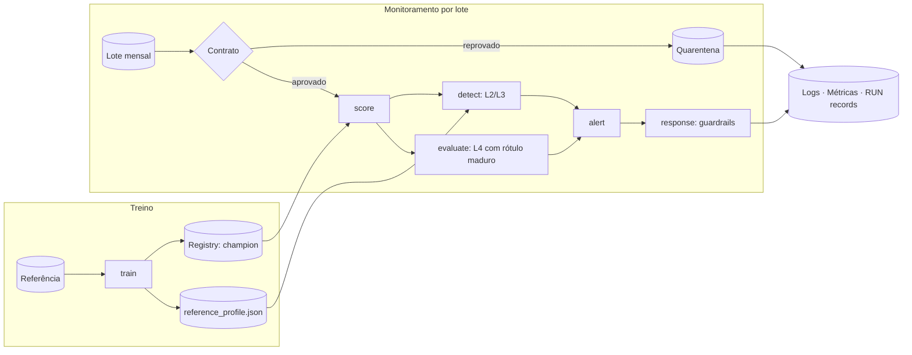

# Arquitetura

> **Status: esqueleto.** Desenho anterior ao código; componentes e fluxos serão confirmados a partir de F6.

## Visão geral

Um modelo de credit scoring pontua lotes mensais de propostas em batch. Cada lote passa por contrato de dados, pontuação, detecção de drift, avaliação de desempenho (quando o rótulo amadurece), alertas e política de resposta. Tudo que acontece gera log estruturado, métricas e um registro de execução.

## Fluxos

## Componentes

| Pacote | Responsabilidade | Fase |
|---|---|---|
| `src/data` | Loader, alvo, allowlist, pseudonimização, separação referência × produção | F1 |
| `src/models` | Treino, avaliação, calibração, limiar por custo, cliente do Registry | F2 |
| `src/contracts` | Contratos Pandera, gate, quarentena, relatório de violação | F3 |
| `src/simulation` | Cenários S0–S5, manifesto de ground truth, gerador de lote ruim | F4 |
| `src/monitoring` | PSI/KS/Wasserstein, perfil de referência, Evidently, desempenho maduro | F5 |
| `src/observability` | Eventos de log, métricas Pushgateway, ledger de runs | F6 |
| `src/alerting` | Motor de severidade e alertas | F6 |
| `src/response` | Policy engine, guardrails, champion/challenger, rollback | F7 |
| `src/governance` | Fairness, checagem de privacidade, retenção | F8 |
| `src/reporting` | RUN records e índices | F2+ |

## Infraestrutura transversal (F0)

- `src/config.py`: configuração via variáveis de ambiente (`CDM_*`) e `.env`.
- `src/logging_config.py`: logs JSON com filtro de privacidade (GR-10), que redige campos pessoais e valores de nível de linha.
- `scripts/check_publication.py`: guarda de publicação (ADR-0002).
