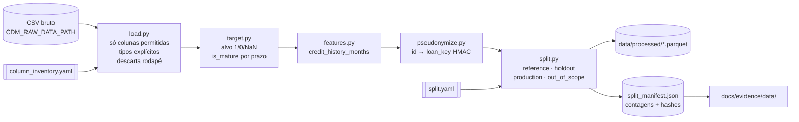
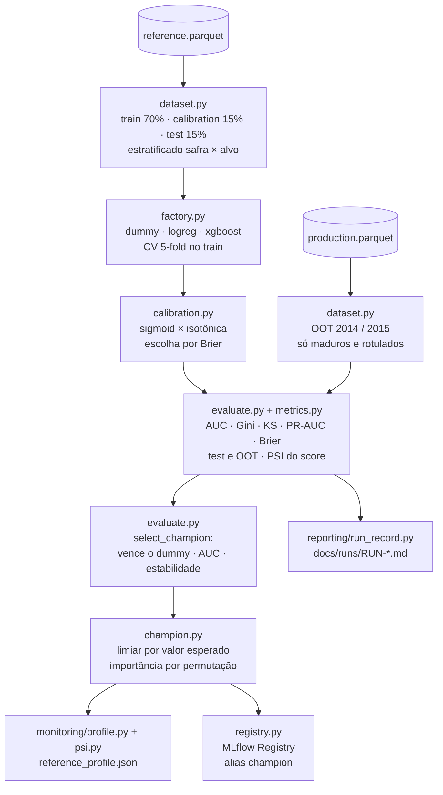
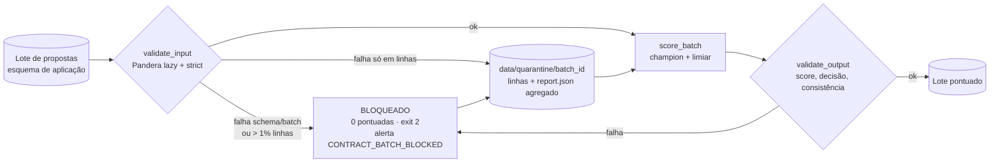
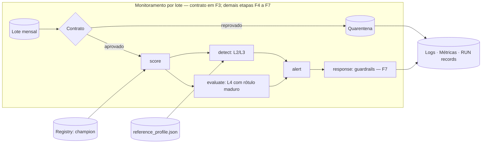

# Arquitetura

> **Status:** preparação de dados (F1), treino (F2) e quality gate (F3) implementados e descritos aqui. Simulação, monitoramento e resposta ainda estão como desenho (a confirmar nas fases F4–F7). Todo módulo de `src/` precisa aparecer neste documento; um teste garante isso (`tests/test_docs_sync.py`).

## Visão geral

Um modelo de credit scoring pontua lotes mensais de propostas em batch. Cada lote passa por contrato de dados, pontuação, detecção de drift, avaliação de desempenho (quando o rótulo amadurece), alertas e política de resposta. Tudo gera log estruturado, métricas e um registro de execução.

## Fluxo implementado — preparação de dados (F1)

`make data` executa `src/data/prepare.py`:

| Etapa | Garantia | Teste |
|---|---|---|
| Carga | Lê só chave, alvo, metadados, segmento e allowlist (+ `earliest_cr_line` e `last_pymnt_d` para derivação/snapshot); nunca texto livre nem pós-originação | `test_load.py`, `test_inventory_features.py` |
| Alvo | Status desconhecido gera erro; maturação = `issue_d + term ≤ snapshot` | `test_target_split.py` |
| Pseudonimização | HMAC-SHA256 com chave do `.env`; sem a chave, falha | `test_target_split.py` |
| Separação | Partições disjuntas, determinísticas por seed, respeitando tempo e escopo | `test_target_split.py` |
| Inventário | 151/151 colunas; doc e lista de PII regenerados do YAML | `test_inventory_features.py` |

## Fluxo implementado — treino (F2)

`make train` executa `src/models/train.py`:

Configuração: `config/models/training.yaml` (partição interna, modelos, calibração, seleção, tipos confiáveis do skops) e `config/models/cost.yaml` (LGD, margem e grade de limiar; status PROPOSTO). Tracking MLflow em SQLite (`mlruns/mlflow.db`), artefatos em `mlruns/artifacts/`, ambos fora do git.

## Fluxo implementado — quality gate (F3)

`make validate` (lote real) e `make validate-bad` (lote com defeitos) executam `src/contracts/cli.py`:

Regras, parâmetros e o caso D6 estão em [DATA_CONTRACTS.md](DATA_CONTRACTS.md); as decisões, no [ADR-0008](adr/0008-data-contracts.md).

## Fluxos planejados

## Componentes

| Módulo | Responsabilidade | Fase | Estado |
|---|---|---|---|
| `src/config.py` | Configuração via `CDM_*`/`.env`; caminhos relativos ancorados na raiz | F0 | implementado |
| `src/logging_config.py` | Logs JSON com filtro de privacidade (GR-10) | F0 | implementado |
| `src/data/inventory.py` | Lê o inventário de colunas; exporta lista de PII e `docs/data_inventory.md` | F1 | implementado |
| `src/data/load.py` | Leitura tipada do CSV bruto, só colunas permitidas; data do snapshot | F1 | implementado |
| `src/data/target.py` | Mapeamento do alvo e maturação do rótulo | F1 | implementado |
| `src/data/features.py` | Allowlist de originação e features derivadas | F1 | implementado |
| `src/data/pseudonymize.py` | `id` → `loan_key` (HMAC) | F1 | implementado |
| `src/data/split.py` | Partições referência/holdout/produção e hash de conteúdo | F1 | implementado |
| `src/data/prepare.py` | Orquestra a preparação e grava parquet + manifesto | F1 | implementado |
| `src/models/settings.py` | Configuração validada de treino e custo | F2 | implementado |
| `src/models/dataset.py` | Partição interna da referência e conjuntos OOT maduros | F2 | implementado |
| `src/models/factory.py` | Factory de pipelines (dummy, logreg, xgboost) | F2 | implementado |
| `src/models/metrics.py` | AUC, Gini, KS de crédito, PR-AUC, Brier, decisão, tabela de calibração | F2 | implementado |
| `src/models/calibration.py` | Calibração pós-treino (Platt/isotônica) e escolha por Brier | F2 | implementado |
| `src/models/threshold.py` | Economia por empréstimo, limiar por valor esperado e sensibilidade às premissas de custo | F2 | implementado |
| `src/models/economics.py` | Economia realizada a partir do caixa do credor (colunas `custo`, só agregados) | F2 | implementado |
| `src/models/cost_calibration.py` | Estima LGD e margem empíricas, escolhe o limiar e valida FP/FN contra o caixa realizado | F2 | implementado |
| `src/models/evaluate.py` | CV, avaliação por conjunto, PSI do score, seleção do champion | F2 | implementado |
| `src/models/champion.py` | Limiar, relatório de decisão, importância, resumo do perfil | F2 | implementado |
| `src/models/registry.py` | Tracking MLflow (SQLite) e alias `champion` no Registry | F2 | implementado |
| `src/models/train.py` | Orquestra o treino e gera os RUN records | F2 | implementado |
| `src/monitoring/psi.py` | PSI com bins fixados pela referência, bin de nulos e de categoria nova | F2 | implementado |
| `src/monitoring/profile.py` | Perfil de referência (bins, score, limiar, bad rate esperado, importância) | F2 | implementado |
| `src/reporting/run_record.py` | RUN records e índice gerados por código | F2 | implementado |
| `src/reporting/experiments.py` | `docs/EXPERIMENTS.md` gerado do MLflow, com link para cada RUN | F2 | implementado |
| `src/contracts/settings.py` | Configuração validada do contrato (`config/contracts/contract.yaml`) | F3 | implementado |
| `src/contracts/rules.py` | Catálogo de regras (id, severidade, escopo) e classificação das falhas do Pandera | F3 | implementado |
| `src/contracts/schema.py` | Schemas Pandera de entrada e saída construídos da config e do perfil de referência | F3 | implementado |
| `src/contracts/validate.py` | Validação `lazy`, decisão bloqueio × quarentena, regras soft | F3 | implementado |
| `src/contracts/report.py` | Relatório de violação só com agregados e escrita da quarentena | F3 | implementado |
| `src/contracts/gate.py` | Quality gate: validar → pontuar → validar saída, ou quarentena + alerta + exit 2 | F3 | implementado |
| `src/contracts/cli.py` | `make validate`, `make validate-bad`, `make contracts-d6` | F3 | implementado |
| `src/contracts/d6.py` | Varredura do bug de unidade (contrato × drift) | F3 | implementado |
| `src/contracts/catalog.py` | Gera `docs/DATA_CONTRACTS.md` a partir das regras, da config e dos defeitos | F3 | implementado |
| `src/simulation/bad_batch.py` | Gerador de lote ruim: 13 defeitos catalogados, cada um com a regra que deve dispará-lo | F3 | implementado |
| `src/simulation/` (restante) | Cenários S0–S5, manifesto de ground truth | F4 | planejado |
| `src/monitoring/` (restante) | KS/χ²/Wasserstein, Evidently, desempenho maduro, avaliação do detector | F5 | planejado |
| `src/observability/` | Eventos de log, métricas Pushgateway, ledger de runs | F6 | planejado |
| `src/alerting/` | Motor de severidade e alertas | F6 | planejado |
| `src/response/` | Policy engine, guardrails, champion/challenger, rollback | F7 | planejado |
| `src/governance/` | Fairness, checagem de privacidade, retenção | F8 | planejado |
| `src/reporting/` (restante) | Sumários de monitoramento e de resposta | F5+ | planejado |

## Configuração versionada

| Arquivo | Conteúdo |
|---|---|
| `config/data/column_inventory.yaml` | Classificação das 151 colunas (fonte única de allowlist e PII) |
| `config/data/split.yaml` | Janelas de referência/produção, fração de holdout, seed |
| `config/governance/pii_columns.txt` | Gerado do inventário; lido pela guarda de publicação |
| `config/models/training.yaml` | Partição interna, modelos, calibração, seleção, tipos confiáveis do skops |
| `config/models/cost.yaml` | Premissas de custo (medidas + funding declarado), grade de limiar e apetite de risco |
| `config/contracts/contract.yaml` | Faixas, domínios, tolerâncias, janelas e parâmetros soft do contrato de dados |

## Infraestrutura transversal

- `scripts/check_publication.py`: guarda de publicação (ADR-0002), executada pelos hooks e pelo CI.
- `Makefile`: interface única de comandos (`make help`).
- Dados, modelos, logs e relatórios ficam fora do git (`/data`, `/models`, `/mlruns`, `/logs`, `/reports`).
