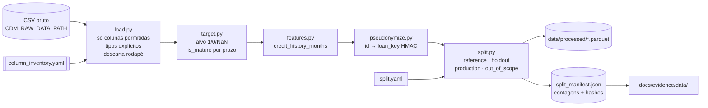
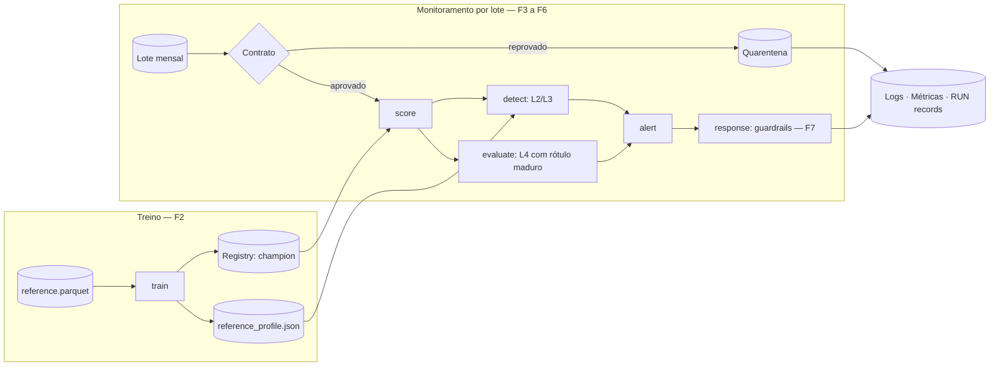

# Arquitetura

> **Status:** preparação de dados (F1) implementada e descrita aqui. Treino, monitoramento e resposta ainda estão como desenho (a confirmar nas fases F2–F7). Todo módulo de `src/` precisa aparecer neste documento; um teste garante isso (`tests/test_docs_sync.py`).

## Visão geral

Um modelo de credit scoring pontua lotes mensais de propostas em batch. Cada lote passa por contrato de dados, pontuação, detecção de drift, avaliação de desempenho (quando o rótulo amadurece), alertas e política de resposta. Tudo gera log estruturado, métricas e um registro de execução.

## Fluxo implementado — preparação de dados (F1)

`make data` executa `src/data/prepare.py`:

| Etapa | Garantia | Teste |
|---|---|---|
| Carga | Lê só chave, alvo, metadados, segmento e allowlist (+ `earliest_cr_line` e `last_pymnt_d` para derivação/snapshot); nunca texto livre nem pós-originação | `test_load.py`, `test_inventory_features.py` |
| Alvo | Status desconhecido gera erro; maturação = `issue_d + term ≤ snapshot` | `test_target_split.py` |
| Pseudonimização | HMAC-SHA256 com chave do `.env`; sem a chave, falha | `test_target_split.py` |
| Separação | Partições disjuntas, determinísticas por seed, respeitando tempo e escopo | `test_target_split.py` |
| Inventário | 151/151 colunas; doc e lista de PII regenerados do YAML | `test_inventory_features.py` |

## Fluxos planejados

## Componentes

| Módulo | Responsabilidade | Fase | Estado |
|---|---|---|---|
| `src/config.py` | Configuração via `CDM_*`/`.env`; caminhos relativos ancorados na raiz | F0 | implementado |
| `src/logging_config.py` | Logs JSON com filtro de privacidade (GR-10) | F0 | implementado |
| `src/data/inventory.py` | Lê o inventário de colunas; exporta lista de PII e `docs/data_inventory.md` | F1 | implementado |
| `src/data/load.py` | Leitura tipada do CSV bruto, só colunas permitidas; data do snapshot | F1 | implementado |
| `src/data/target.py` | Mapeamento do alvo e maturação do rótulo | F1 | implementado |
| `src/data/features.py` | Allowlist de originação e features derivadas | F1 | implementado |
| `src/data/pseudonymize.py` | `id` → `loan_key` (HMAC) | F1 | implementado |
| `src/data/split.py` | Partições referência/holdout/produção e hash de conteúdo | F1 | implementado |
| `src/data/prepare.py` | Orquestra a preparação e grava parquet + manifesto | F1 | implementado |
| `src/models/` | Treino, avaliação, calibração, limiar por custo, cliente do Registry | F2 | planejado |
| `src/contracts/` | Contratos Pandera, gate, quarentena, relatório de violação | F3 | planejado |
| `src/simulation/` | Cenários S0–S5, manifesto de ground truth, gerador de lote ruim | F4 | planejado |
| `src/monitoring/` | PSI/KS/Wasserstein, perfil de referência, Evidently, desempenho maduro | F5 | planejado |
| `src/observability/` | Eventos de log, métricas Pushgateway, ledger de runs | F6 | planejado |
| `src/alerting/` | Motor de severidade e alertas | F6 | planejado |
| `src/response/` | Policy engine, guardrails, champion/challenger, rollback | F7 | planejado |
| `src/governance/` | Fairness, checagem de privacidade, retenção | F8 | planejado |
| `src/reporting/` | RUN records e índices | F2+ | planejado |

## Configuração versionada

| Arquivo | Conteúdo |
|---|---|
| `config/data/column_inventory.yaml` | Classificação das 151 colunas (fonte única de allowlist e PII) |
| `config/data/split.yaml` | Janelas de referência/produção, fração de holdout, seed |
| `config/governance/pii_columns.txt` | Gerado do inventário; lido pela guarda de publicação |

## Infraestrutura transversal

- `scripts/check_publication.py`: guarda de publicação (ADR-0002), executada pelos hooks e pelo CI.
- `Makefile`: interface única de comandos (`make help`).
- Dados, modelos, logs e relatórios ficam fora do git (`/data`, `/models`, `/mlruns`, `/logs`, `/reports`).
