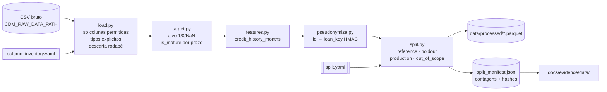
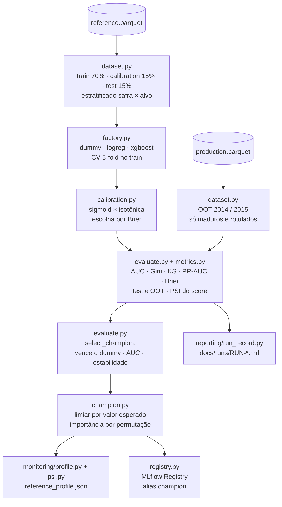
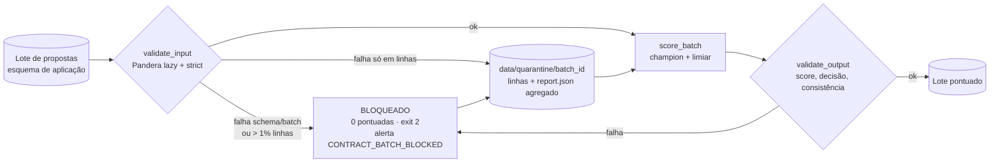
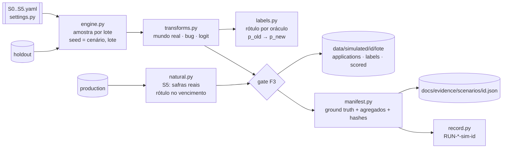
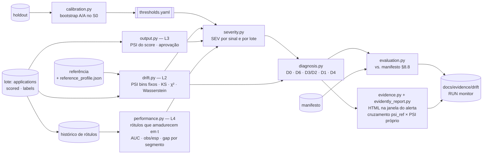
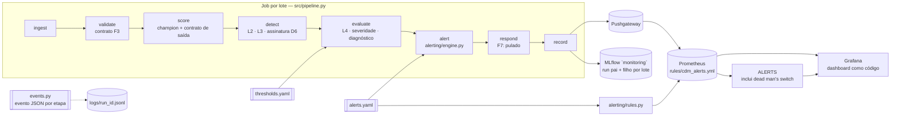

# Arquitetura

> **Status:** preparação de dados (F1), treino (F2), quality gate (F3), simulador de cenários (F4), detecção de drift (F5) e observabilidade (F6) implementados e descritos aqui. A resposta à degradação ainda está como desenho (F7). Todo módulo de `src/` precisa aparecer neste documento; um teste garante isso (`tests/test_docs_sync.py`).

## Visão geral

Um modelo de credit scoring pontua lotes mensais de propostas em batch. Cada lote passa por contrato de dados, pontuação, detecção de drift, avaliação de desempenho (quando o rótulo amadurece), alertas e política de resposta. Tudo gera log estruturado, métricas e um registro de execução.

## Fluxo implementado — preparação de dados (F1)

`make data` executa `src/data/prepare.py`:

| Etapa | Garantia | Teste |
|---|---|---|
| Carga | Lê só chave, alvo, metadados, segmento e allowlist (+ `earliest_cr_line` e `last_pymnt_d` para derivação/snapshot); nunca texto livre nem pós-originação | `test_load.py`, `test_inventory_features.py` |
| Alvo | Status desconhecido gera erro; maturação = `issue_d + term ≤ snapshot` | `test_target_split.py` |
| Pseudonimização | HMAC-SHA256 com chave do `.env`; sem a chave, falha | `test_target_split.py` |
| Separação | Partições disjuntas, determinísticas por seed, respeitando tempo e escopo | `test_target_split.py` |
| Inventário | 151/151 colunas; doc e lista de PII regenerados do YAML | `test_inventory_features.py` |

## Fluxo implementado — treino (F2)

`make train` executa `src/models/train.py`:

Configuração: `config/models/training.yaml` (partição interna, modelos, calibração, seleção, tipos confiáveis do skops) e `config/models/cost.yaml` (LGD, margem e grade de limiar; status PROPOSTO). Tracking MLflow em SQLite (`mlruns/mlflow.db`), artefatos em `mlruns/artifacts/`, ambos fora do git.

## Fluxo implementado — quality gate (F3)

`make validate` (lote real) e `make validate-bad` (lote com defeitos) executam `src/contracts/cli.py`:

Regras, parâmetros e o caso D6 estão em [DATA_CONTRACTS.md](DATA_CONTRACTS.md); as decisões, no [ADR-0008](adr/0008-data-contracts.md).

## Fluxo implementado — simulador de cenários (F4)

`make simulate` executa `src/simulation/cli.py`. Cada cenário (`config/scenarios/S*.yaml`) vira uma sequência de lotes mensais com ground truth conhecido; todo lote passa pelo gate da F3 e é pontuado pelo champion:

Cenários, narrativa e resultados em [SCENARIOS.md](SCENARIOS.md); decisões no [ADR-0017](adr/0017-scenario-simulator.md).

## Fluxo implementado — detecção de drift (F5)

`make calibrate` calibra os limiares no controle; `make detect` roda o detector sobre os lotes de cada cenário (`src/monitoring/cli.py`). O detector vê só o que a produção vê; o manifesto de ground truth é lido apenas pela avaliação:

Metodologia no [ADR-0009](adr/0009-drift-detection-methodology.md); limiares em [THRESHOLDS.md](THRESHOLDS.md); resultados em [DRIFT_EVALUATION.md](DRIFT_EVALUATION.md).

## Fluxo implementado — job de monitoramento e observabilidade (F6)

`make monitor` / `make replay` executam `src/observability/runner.py`, que roda `src/pipeline.py` lote a lote. Decisões: [ADR-0010](adr/0010-observability-stack.md) (stack) e [ADR-0011](adr/0011-severity-alert-policy.md) (alertas).

Um único lugar decide os níveis. As regras do Prometheus só leem `cdm_alert_level`, e o único alerta avaliado só no Prometheus é o dead man's switch. Catálogos gerados: [METRICS.md](METRICS.md) e [ALERTS.md](ALERTS.md); operação: [RUNBOOK.md](RUNBOOK.md).

## Fluxo planejado — resposta (F7)

A etapa `respond` passa a aplicar a política declarativa (§8.5): guardrails, modo conservador, recalibração, challenger, rollback.

## Componentes

| Módulo | Responsabilidade | Fase | Estado |
|---|---|---|---|
| `src/config.py` | Configuração via `CDM_*`/`.env`; caminhos relativos ancorados na raiz | F0 | implementado |
| `src/logging_config.py` | Logs JSON com filtro de privacidade (GR-10) | F0 | implementado |
| `src/data/inventory.py` | Lê o inventário de colunas; exporta lista de PII e `docs/data_inventory.md` | F1 | implementado |
| `src/data/load.py` | Leitura tipada do CSV bruto, só colunas permitidas; data do snapshot | F1 | implementado |
| `src/data/target.py` | Mapeamento do alvo e maturação do rótulo | F1 | implementado |
| `src/data/features.py` | Allowlist de originação e features derivadas | F1 | implementado |
| `src/data/pseudonymize.py` | `id` → `loan_key` (HMAC) | F1 | implementado |
| `src/data/split.py` | Partições referência/holdout/produção e hash de conteúdo | F1 | implementado |
| `src/data/prepare.py` | Orquestra a preparação e grava parquet + manifesto | F1 | implementado |
| `src/models/settings.py` | Configuração validada de treino e custo | F2 | implementado |
| `src/models/dataset.py` | Partição interna da referência e conjuntos OOT maduros | F2 | implementado |
| `src/models/factory.py` | Factory de pipelines (dummy, logreg, xgboost) | F2 | implementado |
| `src/models/metrics.py` | AUC, Gini, KS de crédito, PR-AUC, Brier, decisão, tabela de calibração | F2 | implementado |
| `src/models/calibration.py` | Calibração pós-treino (Platt/isotônica) e escolha por Brier | F2 | implementado |
| `src/models/threshold.py` | Economia por empréstimo, limiar por valor esperado e sensibilidade às premissas de custo | F2 | implementado |
| `src/models/economics.py` | Economia realizada a partir do caixa do credor (colunas `custo`, só agregados) | F2 | implementado |
| `src/models/cost_calibration.py` | Estima LGD e margem empíricas, escolhe o limiar e valida FP/FN contra o caixa realizado | F2 | implementado |
| `src/models/evaluate.py` | CV, avaliação por conjunto, PSI do score, seleção do champion | F2 | implementado |
| `src/models/champion.py` | Limiar, relatório de decisão, importância, resumo do perfil | F2 | implementado |
| `src/models/registry.py` | Tracking MLflow (SQLite) e alias `champion` no Registry | F2 | implementado |
| `src/models/train.py` | Orquestra o treino e gera os RUN records | F2 | implementado |
| `src/monitoring/psi.py` | PSI com bins fixados pela referência, bin de nulos e de categoria nova | F2 | implementado |
| `src/monitoring/profile.py` | Perfil de referência (bins, score, limiar, bad rate esperado, importância) | F2 | implementado |
| `src/reporting/run_record.py` | RUN records e índice gerados por código | F2 | implementado |
| `src/reporting/experiments.py` | `docs/EXPERIMENTS.md` gerado do MLflow, com link para cada RUN | F2 | implementado |
| `src/contracts/settings.py` | Configuração validada do contrato (`config/contracts/contract.yaml`) | F3 | implementado |
| `src/contracts/rules.py` | Catálogo de regras (id, severidade, escopo) e classificação das falhas do Pandera | F3 | implementado |
| `src/contracts/schema.py` | Schemas Pandera de entrada e saída construídos da config e do perfil de referência | F3 | implementado |
| `src/contracts/validate.py` | Validação `lazy`, decisão bloqueio × quarentena, regras soft | F3 | implementado |
| `src/contracts/report.py` | Relatório de violação só com agregados e escrita da quarentena | F3 | implementado |
| `src/contracts/gate.py` | Quality gate: validar → pontuar → validar saída, ou quarentena + alerta + exit 2 | F3 | implementado |
| `src/contracts/cli.py` | `make validate`, `make validate-bad`, `make contracts-d6` | F3 | implementado |
| `src/contracts/d6.py` | Varredura do bug de unidade (contrato × drift) | F3 | implementado |
| `src/contracts/catalog.py` | Gera `docs/DATA_CONTRACTS.md` a partir das regras, da config e dos defeitos | F3 | implementado |
| `src/simulation/bad_batch.py` | Gerador de lote ruim: 13 defeitos catalogados, cada um com a regra que deve dispará-lo | F3 | implementado |
| `src/simulation/settings.py` | Configuração validada dos cenários (transformações, cronograma, resposta esperada) | F4 | implementado |
| `src/simulation/transforms.py` | Intensidade no tempo e transformações (Strategy): mundo real, bug de dado, deslocamento do logit | F4 | implementado |
| `src/simulation/labels.py` | Mecanismo do rótulo: move cada rótulo de `p_old` para `p_new` preservando o desfecho real | F4 | implementado |
| `src/simulation/engine.py` | Gera os lotes de S0–S4 a partir do holdout (puro, seed por lote) | F4 | implementado |
| `src/simulation/natural.py` | S5: safras reais mensais com rótulo só quando maduro | F4 | implementado |
| `src/simulation/manifest.py` | Manifesto de ground truth com agregados e hashes por lote | F4 | implementado |
| `src/simulation/record.py` | RUN record do tipo `sim` por cenário | F4 | implementado |
| `src/simulation/cli.py` | `make simulate`: gera, passa pelo gate, pontua e persiste | F4 | implementado |
| `src/monitoring/settings.py` | Configuração validada dos limiares (`thresholds.yaml`), com direção por sinal | F5 | implementado |
| `src/monitoring/drift.py` | L2: PSI com bins da referência, KS, χ², Wasserstein normalizada por feature | F5 | implementado |
| `src/monitoring/output.py` | L3: PSI do score, taxa de aprovação e variação, bad rate esperado | F5 | implementado |
| `src/monitoring/performance.py` | L4: desempenho dos rótulos que amadurecem no lote, descolamento por segmento | F5 | implementado |
| `src/monitoring/severity.py` | Severidade SEV-0..3 por sinal e por lote (§8.4) | F5 | implementado |
| `src/monitoring/diagnosis.py` | Diagnóstico pela árvore §8.7, com assinatura de bug de unidade (D6) | F5 | implementado |
| `src/monitoring/calibration.py` | Bootstrap A/A no controle e calibração dos limiares | F5 | implementado |
| `src/monitoring/l4_sweep.py` | Varredura do corte SEV-2 da razão observado/esperado: escolha pela distribuição nula, validação em variantes novas | F6 | implementado |
| `src/monitoring/robustness.py` | Estudo de robustez: variantes com seeds novas e magnitude × m, intervalo de Wilson, regra de leitura declarada antes | entre F7 e F8 | implementado |
| `src/monitoring/robustness_run.py` | `make robustness`: simulador → gate → score → detector → avaliação e comparação de respostas por variante, em memória | entre F7 e F8 | implementado |
| `src/monitoring/robustness_doc.py` | Gera `docs/ROBUSTNESS.md` e o RUN record `calib` ROBUST | entre F7 e F8 | implementado |
| `src/monitoring/evidently_report.py` | Relatório Evidently com teste `psi_ref` registrado e explícito por coluna | F5 | implementado |
| `src/monitoring/detect.py` | Detector por lote sobre um cenário (puro) | F5 | implementado |
| `src/monitoring/evaluation.py` | Avaliação do detector contra o ground truth (falso alarme, atraso, atribuição, diagnóstico) | F5 | implementado |
| `src/monitoring/evidence.py` | Janela do alerta, relatório Evidently, cruzamento e RUN record `monitor` | F5 | implementado |
| `src/monitoring/cli.py` | `make calibrate` e `make detect` | F5 | implementado |
| `src/monitoring/docs.py` | Gera `THRESHOLDS.md` e `DRIFT_EVALUATION.md` | F5 | implementado |
| `src/pipeline.py` | Job por lote: ingest → validate → score → detect → evaluate → alert → respond → record; falha de etapa vira alerta | F6 | implementado |
| `src/observability/events.py` | Evento estruturado por etapa e log JSON por run com filtro de privacidade | F6 | implementado |
| `src/observability/metrics.py` | Catálogo de métricas (gera `METRICS.md`) e publicação no Pushgateway | F6 | implementado |
| `src/observability/samples.py` | Estado do lote → amostras das métricas do catálogo | F6 | implementado |
| `src/observability/runner.py` | `make monitor` / `make replay`: laço de lotes, publicação, MLflow, resumo e RUN record | F6 | implementado |
| `src/observability/dashboard.py` | Dashboard do Grafana como código (JSON gerado e testado) | F6 | implementado |
| `src/observability/screenshots.py` | `make screenshots`: prints do painel pela API de render do Grafana | F6 | implementado |
| `src/alerting/settings.py` | Catálogo de alertas validado (`alerts.yaml`) | F6 | implementado |
| `src/alerting/engine.py` | Nível de cada alerta a partir da severidade, do contrato, das etapas e da duração | F6 | implementado |
| `src/alerting/rules.py` | Gera as regras do Prometheus, os testes do `promtool` e `ALERTS.md` | F6 | implementado |
| `src/response/settings.py` | Política de resposta validada (`config/response/policy.yaml`) | F7 | implementado |
| `src/response/policy.py` | Motor da matriz §8.5: primeira regra que casa → ações automáticas e humanas | F7 | implementado |
| `src/response/guardrails.py` | Circuit breaker (GR-4) com histerese, corte por valor esperado com risco corrigido (ADR-0019), fila de revisão com capacidade e excedente recusado (ADR-0021), cadeia de guardrails com código de motivo (GR-9, A2, GR-4) | F7 | implementado |
| `src/response/respond.py` | Etapa `respond` do job: política → breaker → cadeia → decisões finais | F7 | implementado |
| `src/response/lifecycle.py` | Recalibração (A5) e challenger (A6) só com dado aprovado (GR-7) e rótulo maduro (GR-8), em janela recente | F7 | implementado |
| `src/response/gate.py` | Gate de promoção (GR-5): AUC recente, perda na referência, calibração, gap de aprovação entre grupos | F7 | implementado |
| `src/response/registry_ops.py` | Promoção e rollback por troca de aliases no MLflow Registry (GR-6) | F7 | implementado |
| `src/response/shadow.py` | Challenger em sombra (pontua sem decidir, gate a cada rótulo que amadurece) e ensaio de promoção/rollback no registry de ensaio | F7 | implementado |
| `src/response/compare.py` | Valor realizado de cada estratégia de resposta a partir do ponto de decisão | F7 | implementado |
| `src/response/docs.py` | Gera `RESPONSE_EVALUATION.md` e o RUN record `response` | F7 | implementado |
| `src/response/cli.py` | `make respond-compare`, `make respond-drill` e `make rollback` | F7 | implementado |
| `src/response/gameday.py` | `make gameday-watch` / `make gameday`: o job lote a lote na visão do operador (sem manifesto), parando no primeiro alerta da severidade pedida (§11.7) | F7 | implementado |
| `src/response/fairness_cap.py` | Limite de gap de aprovação entre grupos no modo conservador: devolve as propostas retidas de maior valor esperado (motivo R12, ADR-0015) | F8 | implementado |
| `src/governance/fairness.py` | Métricas por grupo (aprovação, igualdade de oportunidade, calibração, AUC), gaps, fairness drift por lote e força de proxy (Cramér's V) | F8 | implementado |
| `src/governance/` | Fairness, checagem de privacidade, retenção | F8 | planejado |
| `src/reporting/` (restante) | Sumários de monitoramento e de resposta | F5+ | planejado |

## Configuração versionada

| Arquivo | Conteúdo |
|---|---|
| `config/data/column_inventory.yaml` | Classificação das 151 colunas (fonte única de allowlist e PII) |
| `config/data/split.yaml` | Janelas de referência/produção, fração de holdout, seed |
| `config/governance/pii_columns.txt` | Gerado do inventário; lido pela guarda de publicação |
| `config/models/training.yaml` | Partição interna, modelos, calibração, seleção, tipos confiáveis do skops |
| `config/models/cost.yaml` | Premissas de custo (medidas + funding declarado), grade de limiar e apetite de risco |
| `config/contracts/contract.yaml` | Faixas, domínios, tolerâncias, janelas e parâmetros soft do contrato de dados |
| `config/response/policy.yaml` | Matriz de resposta §8.5 (regras → ações auto/humanas), kill switch, override do modo conservador, dry-run |
| `config/monitoring/alerts.yaml` | Catálogo de alertas: origem, camada, diagnóstico, ação, dono, playbook; dead man's switch |
| `config/monitoring/l4_sweep.yaml` | Grade de cortes, regra de escolha (declarada antes da execução) e variantes de validação da varredura da L4 |
| `config/monitoring/thresholds.yaml` | Limiares por sinal (SEV-1/2/3, direção, status, RUN de calibração), meta de falso alarme, parâmetros do D6 |
| `config/scenarios/S0.yaml` … `S5.yaml` | Cenários de degradação: transformações, magnitudes, cronograma, seed, resposta esperada |

## Infraestrutura transversal

- `scripts/check_publication.py`: guarda de publicação (ADR-0002), executada pelos hooks e pelo CI.
- `Makefile`: interface única de comandos (`make help`).
- `docker-compose.yml` + `monitoring/` (Prometheus, regras e seus testes do `promtool`, provisionamento e dashboard do Grafana): stack local, imagens com tag fixa, portas só em `127.0.0.1` (ADR-0010).
- Dados, modelos, logs e relatórios ficam fora do git (`/data`, `/models`, `/mlruns`, `/logs`, `/reports`).
