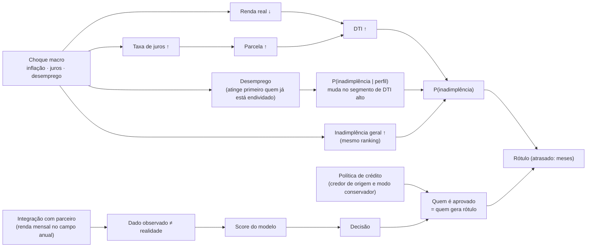

# Análise causal da degradação

A pergunta da diretoria era se o modelo está tomando decisões erradas por causa de mudanças na economia. Responder exige separar três coisas que aparecem misturadas nos alertas:

- **Correlação de drift:** a população de entrada mudou.
- **Causa de degradação:** a relação entre perfil e inadimplência mudou, e o modelo passou a errar.
- **Defeito de dado:** o dado chega errado, sem que nada tenha mudado no mundo.

Este documento monta o grafo causal, mostra como cada mecanismo aparece nas camadas do detector e valida a atribuição contra o ground truth dos cenários. Ele também separa o que é mecanismo conhecido (cenários simulados, com gabarito) do que é hipótese (produção real, sem gabarito).

## 1. Grafo causal

**Como ler:**
- **Choque econômico:** muda o perfil de entrada (renda, DTI, juros) e, por esse caminho, o risco. O modelo já sabe precificar isso, porque a relação perfil → risco não mudou.
- **Desemprego concentrado:** muda a própria relação perfil → risco num segmento. É o concept drift, e o modelo não sabe precificar.
- **Bug de integração:** muda o dado sem mudar o mundo.
- **Política de crédito:** decide quem gera rótulo. É o viés de seleção, e o modo conservador também o altera.

## 2. Do mecanismo ao sinal: correlação de drift × causa de degradação

| Mecanismo (código §8.2) | Muda | Entradas (L2) | Score/decisão (L3) | Desempenho com rótulo (L4) | Resposta certa |
|---|---|---|---|---|---|
| Choque econômico (D1) | P(X) | drift nas variáveis afetadas | pode mudar | **estável**, porque o modelo continua calibrado | registrar; não retreinar |
| Concept drift (D3) | P(Y\|X) | **quieto** | **quieto** | razão observado/esperado sobe, **concentrada num segmento** | modo conservador + challenger |
| Prior shift (D2) | P(Y) | quieto | quieto | razão sobe **por igual**, ordenação preservada | modo conservador + recalibrar |
| Bug de unidade (D6) | o dado | drift abrupto com fator constante | muda | piora (o bug estraga a ordenação) | quarentena e corrigir a fonte; nunca retreinar |

A conclusão central é que **drift de entrada não prova degradação, e degradação não precisa de drift de entrada**. No choque econômico, o detector vê drift forte e o modelo continua certo. No concept drift, o detector não vê nada nas entradas e o modelo erra. Por isso o projeto tem camadas e um diagnóstico, em vez de um alarme único de drift.

## 3. Validação contra o ground truth dos cenários

Cada cenário tem um manifesto com o mecanismo injetado ([SCENARIOS.md](SCENARIOS.md)). O detector não lê o manifesto; a comparação é feita depois.

| Cenário | Mecanismo injetado (manifesto) | O que o detector atribuiu | Acerto |
|---|---|---|---|
| S1 | renda ×0,85, DTI ×1,25, juros +3 p.p. | as 3 features, sem falso positivo; L4 quieta; D1 | 3/3 features, D1 em 7/7 lotes ([RUN-20261115-monitor-S1-01](runs/RUN-20261115-monitor-S1-01.md)) |
| S2 | logit +1,0 em DTI ≥ p70 | segmento `dti` (amplitude de 0,81 a 1,04 em logit); entradas quietas; D3 | D3 em 4/4 lotes ([RUN-20261115-monitor-S2-01](runs/RUN-20261115-monitor-S2-01.md)) |
| S3 | logit +0,5 para todos | descolamento uniforme (amplitude ≤ 0,31); D2 | D2 em 5/5 lotes ([RUN-20261115-monitor-S3-01](runs/RUN-20261115-monitor-S3-01.md)) |
| S4 | renda ÷12 em 30% das linhas | `annual_inc` com assinatura ÷12; D6 | D6 em 7/7 lotes, atraso 0 ([RUN-20261115-monitor-S4-01](runs/RUN-20261115-monitor-S4-01.md)) |

**Com 5 seeds novos e 4 magnitudes** ([ROBUSTNESS.md](ROBUSTNESS.md)), a atribuição se mantém na magnitude oficial, com uma exceção. No S2, quando o primeiro alerta chega cedo, em SEV-1, ainda na rampa, o descolamento pode parecer uniforme e ser lido como D2 por um lote. É o limite da separação D2 × D3 por concentração: ela precisa que o efeito no segmento já tenha amadurecido.

## 4. Produção natural (2014–2018): hipóteses, não causas verificadas

A produção real não tem manifesto. O que se pode afirmar é o que o detector mediu; as causas abaixo são **hipóteses**, não testadas neste projeto.

**O que foi medido** ([DRIFT_EVALUATION.md](DRIFT_EVALUATION.md), [RUN-20261117-monitor-S5-01](runs/RUN-20261117-monitor-S5-01.md)):
- **Entradas:** drift desde 2014-02, puxado por `verification_status` (mix de verificação de renda). Juros (`int_rate`) entram em 2014-09.
- **Score:** a distribuição fica estável em cinco anos (PSI máximo de 0,078).
- **Desempenho:** a razão observado/esperado sobe de 1,03 (coorte de 2014-01) para 1,39 (coorte de 2015-12), com AUC entre 0,67 e 0,71. O modelo subestima o risco sem perder a ordenação, e o diagnóstico é D2 a partir de 2017-09.
- **Regra de aviso do contrato:** a S02 (categoria nova) dispara em 31 dos 60 meses, por dois níveis inexistentes na referência de 2013: `home_ownership = ANY` e `purpose = educational`. É mudança de cadastro na fonte, não drift nem defeito. A resposta é registrar e, se o nível se firmar, revisar o contrato e o inventário. Esta era a pendência da F6.
- **Fairness:** quando o modo conservador age (mar–dez/2018), o gap regional (`addr_state`) cresce de 6 a 11 p.p. e dispara o alerta de fairness. Os segmentos com limite ficam dentro dele (aumento de 4 a 6 p.p.).

**Hipóteses para a causa (não verificadas):**
1. **Mudança de mix e de política do credor de origem:** a mudança em `verification_status` vem antes de tudo e é típica de mudança de processo de originação, não de economia.
2. **Repricing de juros e expansão para perfis mais arriscados** dentro das mesmas faixas de score, o que produziria exatamente "score estável, inadimplência maior": um D2 visto de fora.
3. **Censura do rótulo:** as safras finais (2016 em diante) ainda estão imaturas. O que se vê de 2017–2018 é só a parte madura, e a razão pode estar subestimada.

Testar essas hipóteses exigiria dados de política do credor e de macroeconomia que o dataset não traz.

## 5. Viés de seleção e ciclo de realimentação

- **Viés de seleção:** o dado só tem empréstimos que o credor original aprovou. O modelo nunca viu quem foi recusado, então não sabe avaliar esses perfis (o problema de *reject inference*, [data_card.md](data_card.md)). Toda estimativa de desempenho vale para a população aprovada.
- **Realimentação:** o modo conservador e o limite de fairness mudam quem é aprovado, e portanto quem vai gerar rótulo. Um challenger treinado só com os rótulos do período conservador aprende com uma população filtrada pela própria resposta. Por isso o treino exige rótulo maduro (GR-8) e passa pelo gate de promoção (GR-5), em vez de usar qualquer rótulo que chegue.

## 6. Causa raiz do INC-0001

[INC-0001](incidents/0001-s2-concept-drift-dti.md): bad rate acima do esperado no segmento de DTI alto, no game day do S2.

- **Causa no mundo (manifesto):** desemprego que atinge primeiro quem já está endividado. A probabilidade de inadimplência sobe (logit +1,0) para DTI ≥ p70, sem nenhuma mudança nas entradas (seção 1, caminho "Desemprego").
- **Por que o sistema demorou** (5 lotes do início até o SEV-2):
  1. Atraso de rótulo de 3 lotes: nada em L4 antes do lote 6.
  2. Rampa gradual, em que a razão passou por 1,06 e 1,19, abaixo do SEV-1, sem aviso.
  3. Entradas e score quietos por natureza do mecanismo, como o grafo prevê.
- **O que a análise causal corrigiu no processo:** a árvore de triagem separava D2 de D3 pela queda de AUC. O grafo mostra por que isso falha: o concept drift num segmento muda o *nível* do risco ali, sem necessariamente piorar a *ordenação* global. A triagem passou a usar a concentração no segmento (RUNBOOK).

## Limites

- **Mecanismos simulados:** os cenários foram desenhados para o projeto. A validação da seção 3 mostra que o detector recupera esses mecanismos, não que recuperaria qualquer mecanismo real.
- **Causas não identificadas:** na produção natural, o projeto mede efeitos e diagnostica o tipo, mas não identifica causas. A seção 4 é explicitamente hipótese.
