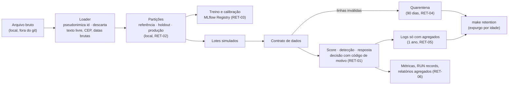

# Governança, privacidade e vieses

> **Aviso de escopo: documento acadêmico.**
> Este projeto é um trabalho acadêmico. **Não existe fintech, cliente, titular atendido nem modelo em produção.**
> - A seção 1 descreve a situação real do projeto.
> - As seções 2 a 9 são um **plano para um cenário hipotético**: a fintech do enunciado, se este modelo fosse usado em produção.
> - Nada aqui é parecer jurídico, nem foi revisado por profissional do direito, e não deve ser usado como orientação legal.
> - Os artigos citados foram conferidos no texto vigente publicado pelo Planalto em 2026-11-17.
>
> Decisões: [ADR-0014](adr/0014-privacy-legal-basis-retention.md) (dados pessoais, base legal e retenção) e [ADR-0015](adr/0015-bias-mitigation.md) (mitigação de vieses).

## 1. Situação real do projeto

| Pergunta | Resposta |
|---|---|
| Que dado é tratado? | Dataset público do Lending Club (Kaggle, licença CC0): empréstimos de pessoas reais nos Estados Unidos, de 2007 a 2018, sem nome, com quase-identificadores ([data_card.md](data_card.md)) |
| A LGPD alcança o projeto? | O processamento acontece no Brasil (LGPD art. 3º, I), mas tem fins **exclusivamente acadêmicos**, hipótese em que a lei não se aplica, exceto os arts. 7º e 11 (art. 4º, II, "b") |
| Qual a base legal (art. 7º)? | Dado de acesso público, tratado considerando a finalidade, a boa-fé e o interesse que justificaram sua disponibilização (art. 7º, §3º), numa nova finalidade legítima e específica, com os princípios preservados (art. 7º, §7º) |
| Há dado pessoal sensível (art. 11)? | Não. Nenhuma das 151 colunas está entre as categorias do art. 5º, II ([data_inventory.md](data_inventory.md)) |
| O dado é anônimo? | Não é tratado como anônimo. Com quase-identificadores, a reidentificação é plausível (art. 12), então o projeto o trata como **pseudonimizado** e aplica minimização e privacidade desde a concepção, mesmo sem obrigação legal |
| O que é publicado? | Só código, configuração e agregados. Nenhuma linha de dado é versionada, e a verificação de publicação bloqueia `data/`, `models/`, `logs/` e padrões de segredo |

## 2. Inventário e fluxo de dados

As 151 colunas estão classificadas em [data_inventory.md](data_inventory.md), gerado de `config/data/column_inventory.yaml`:

| Classe | Colunas | Destino |
|---|---|---|
| Identificador direto | 3 | `id` vira chave pseudonimizada (HMAC-SHA256 com chave do `.env`); `member_id` (vazio) e `url` são descartados |
| Quase-identificador | 18 | 13 descartados (texto livre `emp_title`, `desc` e `title`; `zip_code`; datas brutas; campos de co-tomador, pós-originação ou redundantes); 4 viram features (`annual_inc`, `emp_length`, `home_ownership`, `fico_range_low`); `addr_state` fica fora do modelo e só serve a fairness e monitoramento |
| Não pessoal | 130 | 28 features, 7 colunas de custo, alvo, 2 metadados e 92 descartados (vazamento pós-originação, redundância, escopo) |

## 3. Finalidade e base legal na fintech (cenário)

- **Finalidade:** decidir a concessão de crédito pessoal e monitorar a qualidade dessa decisão ao longo do tempo.
- **Base legal:** **proteção do crédito** (LGPD art. 7º, X, "inclusive quanto ao disposto na legislação pertinente"), hipótese de tratamento própria, independente do consentimento.
- **Princípios aplicados:**
  - **Necessidade** (art. 6º, III): só as colunas da allowlist de originação entram no modelo, e uma coluna nova não entra por omissão (contrato com `strict=True`).
  - **Não discriminação** (art. 6º, IX): análise de vieses e limite de gap entre grupos (seção 8).
- **Cadastro positivo:** se a fintech consultasse cadastro positivo (Lei 12.414/2011), as informações de adimplemento ficariam limitadas a 15 anos (art. 14). Informação negativa em cadastro de consumidor fica limitada a 5 anos (CDC art. 43, §1º).

## 4. Minimização e pseudonimização

| Medida | Onde | Efeito |
|---|---|---|
| Allowlist de features de originação | `src/data/features.py`, contrato `strict=True` | Coluna nova ou pós-originação é rejeitada, não aceita por omissão |
| Pseudonimização do id | `src/data/pseudonymize.py` | HMAC-SHA256 com chave fora do repositório; o id original não sai do loader |
| Descarte de texto livre e CEP | inventário | Remove os quase-identificadores mais fortes |
| `addr_state` fora do modelo | inventário, ADR-0015 | A região não decide crédito; só é usada para medir viés |
| Logs só com agregados | GR-10, `tests/test_observability.py` | Teste falha se aparecer campo pessoal em log |
| Evidência só agregada | verificação de publicação | HTML de evidência com tabela de linhas é bloqueado |

## 5. Direitos do titular e revisão de decisão automatizada (cenário)

- **Direitos do art. 18:** confirmação e acesso, correção, anonimização, bloqueio ou eliminação de dado desnecessário, portabilidade, informação sobre compartilhamento.
  - **Atendimento:** pelo canal do controlador, localizando o titular pela chave pseudonimizada, que a fintech consegue recalcular com a chave HMAC.
- **Revisão de decisão automatizada (LGPD art. 20; Lei 12.414/2011, art. 5º, VI).**
  - **O que a lei pede:** o titular pode pedir revisão de decisão tomada unicamente por tratamento automatizado, inclusive de crédito.
  - **O que o projeto faz além disso:** desde a Lei 13.853/2019, a revisão não precisa ser feita por pessoa natural. Mesmo assim, o modo conservador manda os casos limítrofes para **revisão humana antes** da decisão (motivo R10), dentro de uma fila com capacidade declarada ([ADR-0021](adr/0021-review-queue-capacity.md)).
- **Critérios da decisão** (art. 20, §1º: informações claras sobre critérios e procedimentos). Toda decisão sai com código de motivo:

| Código | Decisão | Motivo |
|---|---|---|
| R00 | aprovado | score abaixo do limiar do modelo |
| R01 | recusado | score acima do limiar do modelo |
| R10 | revisão humana | modo conservador: valor esperado não positivo com o risco corrigido |
| R11 | recusado | modo conservador: fila de revisão cheia e valor esperado entre os piores |
| R12 | aprovado | limite de gap de aprovação entre grupos no modo conservador (ADR-0015) |
| R20 | revisão humana | decisão automática suspensa (kill switch) |
| R30 | revisão humana | lote em quarentena preventiva (suspeita de dado quebrado) |

## 6. Plano de retenção (cenário, premissas do autor)

Fonte única: `config/governance/retention.yaml`. Âncoras legais conferidas: eliminação ao fim do tratamento, com exceções (LGPD art. 16), e informação negativa por até 5 anos (CDC art. 43, §1º).

| Id | Dado | Prazo | Justificativa | Mecanismo |
|---|---|---|---|---|
| RET-01 | Proposta, features de originação e decisão com código de motivo | duração do contrato + 5 anos | contestação e revisão (LGPD arts. 18 e 20); referência do CDC art. 43 §1º | eliminação ou anonimização ao fim do prazo |
| RET-02 | Partições pseudonimizadas de treino e referência | vida útil do modelo + 5 anos | auditoria do modelo e reprodução de decisões contestadas | neste projeto, local e nunca versionado |
| RET-03 | Artefatos de modelo e perfil de referência | vida útil do modelo + 5 anos | explicar decisões tomadas pelo modelo (art. 20, §1º) | MLflow Registry |
| RET-04 | Linhas em quarentena (valores brutos inválidos) | 90 dias | só para corrigir a fonte (art. 6º, III) | `make retention` |
| RET-05 | Logs de execução (só agregados) | 1 ano | auditoria operacional | `make retention` |
| RET-06 | RUN records, relatórios e evidências agregadas | sem prazo | não são dado pessoal | versionados |

`make retention` lista o que passou do prazo; `make retention APPLY=1` apaga. Neste projeto, RET-04 e RET-05 têm expurgo executável. Os outros itens descrevem o cenário.

## 7. Privacidade no próprio monitoramento

O monitoramento também trata dado pessoal e segue as mesmas regras:
- O detector e o job só emitem agregados: PSI por feature, taxas por lote, contagens.
- A quarentena guarda as linhas inválidas com os valores brutos, por isso tem o prazo mais curto (RET-04) e nunca sai da máquina.
- Prints e relatórios HTML do Evidently versionados são conferidos pela verificação de publicação: só agregados.
- Métricas no Prometheus e no Grafana não carregam id de proposta. Os rótulos são lote, etapa, feature, segmento e regra.

## 8. Vieses e mitigação

Detalhes em [FAIRNESS.md](FAIRNESS.md) ([RUN-20261117-fairness-ALL-01](runs/RUN-20261117-fairness-ALL-01.md)) e no [ADR-0015](adr/0015-bias-mitigation.md).

- **Grupos disponíveis:** `home_ownership`, faixas de `emp_length` e `addr_state`. O dado não tem gênero nem idade, então não é possível medir viés nessas dimensões.
- **Regime normal: sem gap relevante.** O champion aprova 99,8%, e o gap de aprovação entre grupos fica abaixo de 0,3 p.p. A calibração por grupo fica entre 0,95 e 1,09 em `home_ownership` e `emp_length`.
- **Modo conservador: gaps grandes.**
  - Sem mitigação, quem aluga perde de 13 a 19 p.p. de aprovação em média, e quem não informou o tempo de emprego, cerca de 40 p.p.
  - **Mitigação aplicada:** nenhum grupo de `home_ownership` ou `emp_length` fica mais de 7 p.p. abaixo do mais aprovado. As propostas retidas de maior valor esperado voltam a ser aprovadas (R12).
  - **Custo medido:** 7% do ganho do modo conservador no S2 e 4% no S3.
  - `addr_state` fica só monitorado, porque está fora do modelo de propósito.
- **Monitoramento contínuo:** o gap da decisão contra o do champion puro é medido em todo lote (`cdm_fairness_gap_pp`), com o alerta `CDM_FAIRNESS_GAP`.

## 9. Relatório de impacto simplificado (cenário)

Riscos aos titulares e mitigações (LGPD art. 5º, XVII, e art. 38, parágrafo único):

| Risco | Probabilidade | Impacto | Mitigação | Risco residual |
|---|---|---|---|---|
| Reidentificação por quase-identificadores | baixa | alto | Descarte de texto livre, CEP e datas; HMAC no id; só agregados publicados | Combinação renda + estado + emprego segue no dado de treino (local) |
| Decisão errada por modelo degradado sem que ninguém perceba | média | alto | Detector em camadas, alertas, modo conservador, game day | Concept drift fraco passa sem detecção ([ROBUSTNESS.md](ROBUSTNESS.md)) |
| Discriminação indireta na resposta à degradação | alta sem mitigação | alto | Limite de gap de 7 p.p. (ADR-0015) e alerta de fairness | Gap regional não limitado; gênero e idade não mensuráveis |
| Recusa automática sem possibilidade de revisão | baixa | médio | Códigos de motivo; revisão humana na faixa limítrofe; kill switch | Excedente da fila recusado automaticamente (R11), com motivo |
| Retenção além do necessário | média | médio | Prazos declarados; expurgo executável da quarentena e dos logs | Expurgo de RET-01 a RET-03 é procedimento, não código, no cenário |
| Vazamento por publicação acidental | baixa | alto | Verificação de publicação local, no pre-commit e no CI; dados fora do git | — |
| Viés de seleção (só empréstimos aprovados pelo credor de origem) | certa | médio | Declarado no data card e no model card; não se infere o desempenho dos recusados | O modelo não sabe avaliar perfis que o credor original recusava |

## Limitações

- **Prazos:** são premissas do autor (PROPOSTO), não exigências legais medidas.
- **Enquadramento legal:** é leitura de texto legal conferido, não parecer.
- **Atributos protegidos clássicos** (gênero, idade, raça) não existem no dado. A análise de vieses cobre só os grupos disponíveis.
