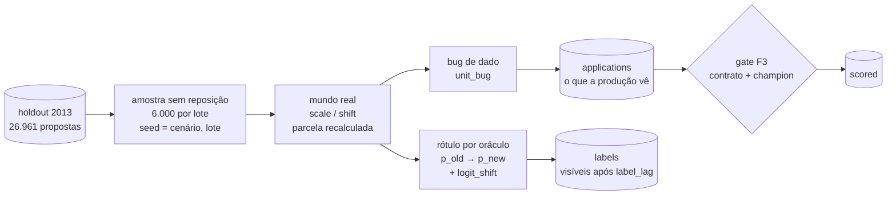

# Cenários de degradação

Lotes mensais com degradação **controlada e conhecida**, para que o detector (F5) e a política de resposta (F7) sejam avaliados contra uma resposta certa. As decisões de desenho estão no [ADR-0017](adr/0017-scenario-simulator.md).

- **Gerar:** `make simulate` (todos) ou `make simulate SCENARIO=S2`.
- **Configuração:** `config/scenarios/S*.yaml`, validada por Pydantic; nenhuma magnitude mora no código.
- **Saídas locais** (fora do git): `data/simulated/<id>/<lote>/{applications,labels,scored}.parquet` e `manifest.json`.
- **Evidência versionada:** `docs/evidence/scenarios/<id>.json`, com o manifesto agregado (ground truth, hashes, agregados por lote, RUN-id).

## Como um lote é construído

A ordem importa:
- **O bug altera só o dado observado.** O rótulo é calculado sobre o X verdadeiro, então um bug nunca muda a inadimplência.
- **No S1, o rótulo acompanha a mudança de X.** Ele segue a P(Y|X) da referência, o que representa drift sem degradação.
- **No S2 e no S3, X fica intacto e o mecanismo do rótulo muda.**

## Cenários

| Id | Nome | Tipo (§8.2) | O que muda | Forma no tempo | Camadas que devem acusar | Diagnóstico certo |
|---|---|---|---|---|---|---|
| S0 | Controle sem drift | — | nada | — | nenhuma | nenhum (falso alarme se acusar) |
| S1 | Choque econômico (inflação e juros) | D1 covariate shift | `annual_inc` × 0,85 · `dti` × 1,25 · `int_rate` + 3 p.p. | gradual: início no lote 3, pleno no lote 8 | L2, L3 | D1 |
| S2 | Concept drift no DTI alto | D3 concept drift | logit de P(default \| X) + 1,0 quando `dti` ≥ p70 da referência | gradual: início no lote 3, pleno no lote 6 | L4 | D3 |
| S3 | Prior shift (recessão generalizada) | D2 prior shift | logit + 0,5 para todos | súbito no lote 4 | L4 | D2 |
| S4 | Bug upstream (renda mensal) | D6 bug com cara de drift | 30% das linhas com `annual_inc` ÷ 12 | súbito no lote 5 | L2, L3 | D6 |
| S5 | Produção natural (safras reais) | real, sem ground truth | safras 2014-01 a 2018-12 | — | L2, L3, L4 | desconhecido |

Parâmetros comuns de S0 a S4: 12 lotes de 6.000 propostas, calendário simulado a partir de 2014-01 e rótulo visível 3 lotes depois (`label_lag`). O S5 usa os 60 meses reais, com o tamanho real de cada mês e o atraso real do rótulo.

**Por que essas features no S1:** são as de maior importância por permutação do champion. `int_rate` é a 1ª, `annual_inc` a 3ª e `dti` a 9ª (`models/reference_profile.json`, [RUN-20261113-train-REF-02](runs/RUN-20261113-train-REF-02.md)). O drift atinge variáveis que de fato pesam na decisão (RO-11).

## Narrativa econômica

**S0 — controle.** Mesma população da referência, sem nenhuma alteração. Serve para medir quantas vezes o detector alarma quando nada mudou, e é a base da calibração dos limiares na F5.

**S1 — choque econômico.** A inflação acumulada corrói a renda real (−15%). O comprometimento de renda sobe (+25% no DTI), e o custo de funding repassado eleva os juros em 3 p.p., com a parcela recalculada pela amortização. A população fica mais arriscada, mas a relação entre perfil e inadimplência não muda. O modelo deve continuar calibrado: o score sobe porque o risco subiu. É o caso do princípio "drift não é degradação" (§8.1): o alerta certo é de atenção, não de retreino.

**S2 — concept drift.** O desemprego atinge primeiro quem já está muito endividado. Com o mesmo DTI, quem está no topo da distribuição passa a inadimplir mais. Nada muda nas entradas, então contrato, drift de entrada e score ficam quietos. Só o desempenho com rótulo maduro revela o problema, e com atraso. Este é o cenário da "degradação silenciosa" do enunciado.

**S3 — prior shift.** Uma recessão eleva a inadimplência de forma uniforme. O ranking do modelo continua válido (AUC estável), mas o bad rate observado descola do esperado. A resposta certa é recalibrar, não retreinar.

**S4 — bug upstream.** Um parceiro de originação, com ~30% das propostas, troca de sistema e passa a enviar a renda mensal no campo de renda anual. A realidade não mudou, mas o dado sim, e o modelo passa a ver clientes mais pobres do que são. Com 30% das linhas, a mediana do lote fica dentro da banda do contrato (H10), e o bug escapa da camada L0. O detector precisa reconhecer a assinatura de bug: mudança abrupta, de um lote para o outro, por fator constante (÷ 12). Nunca se retreina em cima disso (§8.1, princípio 4).

**S5 — produção natural.** Os meses reais posteriores à referência. O drift aqui não foi injetado: juros caindo, mudança de mix e censura do rótulo. Pela regra de maturação, só os contratos de 36 meses emitidos até 2016-03 e os de 60 meses até 2014-03 têm rótulo no snapshot.

## Resultados da geração

<pendente — preenchido com os RUN records da execução oficial>
